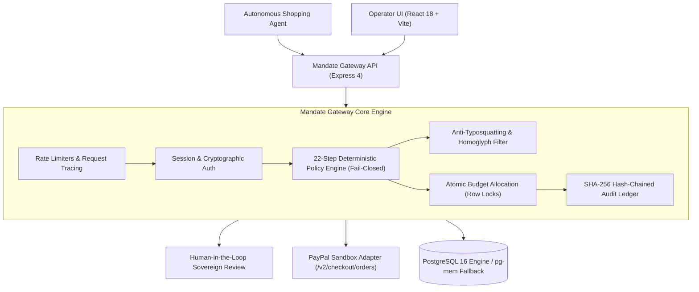

# Mandate Gateway — User-Controlled Authorization Layer for AI Shopping Agents

> **Deterministic Policy Firewall, Spend Governance & PayPal Sandbox Payment Orchestration for Autonomous E-Commerce Agents**  
> Built for the PayPal AI Hackathon • Repository: [https://github.com/Rahullande08/straw-hats](https://github.com/Rahullande08/straw-hats)

---

## 1. Executive Summary & Problem Space

Autonomous AI shopping agents (powered by Claude, Gemini, GPT-4o, and Perplexity) are rapidly transitioning from informational research assistants into autonomous checkout actors. However, handing generative AI models direct payment credentials or unfettered checkout capability creates critical risks:

1. **Prompt Injection & Limit Evasion**: Adversarial web pages or prompt injections can trick shopping models into overriding spending limits, buying luxury items, purchasing untrusted gift cards, or sending funds to rogue merchants.
2. **Hallucinated Compliance & Dealbreaker Overrides**: LLMs easily compromise user specifications (e.g. buying a battery-powered device when the user strictly mandated a rechargeable USB-C model).
3. **Runaway Autonomous Spending**: Without atomic budget ceilings and hard deterministic bounds, an autonomous agent can drain cards in rapid automated loops.
4. **Credential Leakage**: Exposing raw card numbers, CVVs, or persistent banking credentials to third-party merchant scraping endpoints creates severe PCI-DSS liability and fraud exposure.

### The Mandate Gateway Solution
**Mandate Gateway** establishes a zero-trust, fail-closed policy enforcement proxy between generative shopping agents, product providers, merchant storefronts, and PayPal payment rails.

**Core Invariant**: *AI models may search, compare, and recommend purchases, but generative code NEVER decides whether an order is allowed or paid.* Every purchase request is deterministically validated by a 22-step Policy Engine against user-defined spending mandates, audited, and processed via PayPal Sandbox payment intents with zero raw card exposure.

---

## 2. System Architecture & Workflow



### 5-Step Mandate-to-Purchase Flow
1. **User Sets Mandate**: Define strict constraints (e.g., "Home Office", INR 50,000 budget, max INR 5,000/item, Amazon India & Croma whitelisted, electronics only).
2. **AI Agent Finds Products**: The agent searches via the modular product provider (Channel3 adapter) and submits purchase candidates.
3. **Deterministic Policy Check**: The 22-step policy engine evaluates rules with zero LLM hallucinations. Compliant items under threshold auto-clear; sensitive items trigger human review.
4. **Human Review (HITL)**: Purchases exceeding auto-clear thresholds require explicit sovereign confirmation before order creation.
5. **PayPal Sandbox Settlement**: The payment service initiates and captures PayPal sandbox orders with anti-replay guarantees and zero raw financial credential leakage.

---

## 3. Persistent Backend & Full-Stack Architecture

Mandate Gateway features a production-ready, persistent **modular monolith backend** in modern Node.js (ES modules):

- **Express 4 API Layer**: Clean MVC/Service/Repository separation with typed errors and RFC-7807 problem responses.
- **Relational PostgreSQL 16 Persistence**: 14 normalized tables covering users, sessions, merchants, mandates, agent passports, purchase requests, locked evidence, approvals, payment methods, payments, security events, and audit logs.
- **Zero Floating-Point Financial Math**: All amounts stored and computed in integer minor currency units (`cents` / `paise`).
- **Universal Database Engine Portability**: High-performance connection pooling via `pg.Pool` when `DATABASE_URL` is set, with an automatic fallback to an embedded in-memory PostgreSQL engine (`pg-mem`) for zero-dependency local runs and CI testing.
- **Dual Mode Operation (`VITE_APP_MODE`)**:
  - `VITE_APP_MODE=api`: Frontend communicates with the live Express/PostgreSQL backend via `/api`.
  - `VITE_APP_MODE=demo`: Frontend runs purely client-side with rich in-browser mock state (ideal for offline evaluations or static hosting).

---

## 4. Sponsor Tool Integrations & Design Decisions

### A. Channel3 Integration (Product Discovery & Checkout Adapter)
- **Architecture**: Implemented a decoupled `ProductProvider` base class and `DemoChannel3ProductProvider` in [`src/services/productProvider.js`](file:///src/services/productProvider.js).
- **Functionality**:
  - Structured search with category, subcategory, must-haves, and price bounds.
  - Realistic merchant product catalog (Amazon India, Croma, Reliance Digital, Tata CLiQ).
  - Verifiable product specs and quote evidence digests.
  - Side-by-side candidate comparison matrix.

### B. Postman Integration (API Governance & Testing)
- **Artifact**: [`postman_collection.json`](file:///postman_collection.json).
- **Structure**: 12 organized folders matching the complete gateway lifecycle:
  1. Health & System (`GET /health`)
  2. Session & Auth (`GET /session`, `POST /login`, `POST /logout`, `POST /register`)
  3. Dashboard State (`GET /dashboard`)
  4. Mandates (`GET /mandates`, `POST /mandates`, `PUT /mandates/:id`, `POST /mandates/:id/revoke`)
  5. Shopping Agent (`POST /agent/parse-brief`, `POST /agent/evaluate-candidates`)
  6. Deterministic Policy (`POST /policy/evaluate`)
  7. Purchase Requests (`GET /requests`, `POST /requests`, `POST /requests/:id/approve`, `POST /requests/:id/reject`, `GET /requests/:id/dispute-pack`)
  8. Payment Rails & PayPal Sandbox (`GET /payment-methods`, `POST /payment-methods/connect`, `POST /payment-methods/:id/toggle-freeze`, `POST /payment-methods/:id/limits`)
  9. Agent Passports & Merchant Verification (`GET /passports`, `POST /passports`, `POST /passports/:id/revoke`, `GET /passports/verify/:token`)
  10. Activity & Audit Logs (`GET /activity`, `GET /activity/export`)
  11. Security & Resilience (`GET /security/attacks`, `POST /security/run-attacks`, `POST /security/check-message`, `GET /security/kill-switch`, `POST /security/kill-switch/toggle`, `GET /security/verify-ledger`)
  12. Settings (`GET /settings`, `POST /settings`)

### C. APIMatic Integration (SDK & API Documentation)
- **Artifact**: [`openapi.yaml`](file:///openapi.yaml).
- **Readiness**: Formatted in standard OpenAPI 3.0.3, compliant with APIMatic validation rules, enabling one-click generation of client SDKs (TypeScript, Python, Java, C#) and interactive API documentation portals.

---

## 5. PayPal Sandbox Integration & Payment Lifecycle

Mandate Gateway orchestrates payments through an explicit 7-stage lifecycle implemented in [`src/services/paymentService.js`](file:///src/services/paymentService.js) and [`server/services/paypal.service.js`](file:///server/services/paypal.service.js):

| State | Description | Transition Trigger |
| :--- | :--- | :--- |
| `NOT_CONFIGURED` | Gateway has no active PayPal credentials linked. | Operator connects sandbox client ID. |
| `SANDBOX_CONFIGURED` | Linked to `api-m.sandbox.paypal.com` with zero raw credentials stored. | Ready for purchase authorizations. |
| `CREATING_ORDER` | Policy engine has approved order; initiating PayPal sandbox intent. | POST `/v2/checkout/orders` call. |
| `AWAITING_APPROVAL` | High-value purchase flagged for human-in-the-loop sovereign review. | Human clicks "Approve Purchase". |
| `PAYMENT_PENDING` | Order created; awaiting simulated capture or buyer checkout token. | Automated sandbox capture. |
| `COMPLETED` | Simulated order captured; anti-replay capture ID minted. | Transaction finalized; logged to audit. |
| `FAILED_OR_CANCELLED` | Order failed policy checks, was rejected by human, or timed out. | Final terminal failure state. |

> **Sandbox Intent Disclosure**: PayPal is the payment integration rail. All financial transactions execute in isolated sandbox mode. No live financial settlements or card charges occur.

---

## 6. Judge Demo Walkthrough: 6 Deterministic Scenarios

In the **Shopping Agent (`/agent`)** page, judges can click 6 pre-configured scenario buttons to test the deterministic policy engine:

1. **Auto-Clear (Compliant Mouse — INR 2,499)**:
   - *Input*: Portronics Toad One Wireless Mouse on Amazon India (Whitelisted).
   - *Verdict*: **`ALLOW` (Auto-Cleared)**.
2. **Flagged for Human Review (Dell 4K Monitor — INR 42,500)**:
   - *Input*: Dell UltraSharp 27 4K Monitor on Amazon India (Whitelisted).
   - *Verdict*: **`FLAG_HUMAN` (Requires Sovereign Approval)**.
3. **Blocked: Over-Budget (Apple Studio Display — INR 159,900)**:
   - *Input*: Apple Studio Display Nano-Texture on Croma.
   - *Verdict*: **`BLOCK` (Budget Exceeded)**.
4. **Blocked: Blacklisted Merchant (Rogue Cables — INR 1,200)**:
   - *Input*: High-Speed HDMI 2.1 Cable on AliExpress.
   - *Verdict*: **`BLOCK` (Merchant Untrusted)**.
5. **Blocked: Disallowed Category (Gold Coin — INR 8,500)**:
   - *Input*: 1g 24K Gold Coin on Amazon India.
   - *Verdict*: **`BLOCK` (Category Violation)**.
6. **Blocked: Dealbreaker Mismatch (Battery Mouse — INR 1,899)**:
   - *Input*: Disposable AA-battery mouse when user specified rechargeable USB-C.
   - *Verdict*: **`BLOCK` (Spec Compliance Failure)**.

---

## 7. Security Architecture & Attestation Truthfulness

| Security Layer | Implementation File | Verification & Truthful Disclosure |
| :--- | :--- | :--- |
| **Deterministic Invariants** | [`server/services/policy.service.js`](file:///server/services/policy.service.js) | Evaluates 22 constraints in compiled JavaScript. Defaults to `BLOCK`. Zero AI drift. |
| **Emergency Global Kill-Switch** | [`server/services/killSwitch.service.js`](file:///server/services/killSwitch.service.js) | Centralized circuit breaker instantly halting all incoming purchase authorizations. |
| **Anti-Typosquatting & Homoglyphs** | [`server/services/merchantVerification.service.js`](file:///server/services/merchantVerification.service.js) | Levenshtein distance matching, punycode `xn--` detection, and domain canonicalization. |
| **Tamper-Evident Audit Ledger** | [`server/services/audit.service.js`](file:///server/services/audit.service.js) | Immutable SHA-256 hash chain with runtime ledger verification endpoint (`/api/security/verify-ledger`). |
| **Formula Injection Defense** | [`server/services/audit.service.js`](file:///server/services/audit.service.js) | Sanitizes CSV export fields starting with `=`, `+`, `-`, `@`, `\t`, `\r` to protect Excel users. |
| **Zero Raw Financial Exposure** | [`server/services/paypal.service.js`](file:///server/services/paypal.service.js) | Raw credit card numbers and CVVs are never collected or stored. Ephemeral sandbox tokens are used exclusively. |
| **Agent Passport Attestation** | [`server/services/passport.service.js`](file:///server/services/passport.service.js) | **Truthful Disclosure**: Agent Passports use SHA-256 token digests and software DID envelopes for hackathon evaluation (not hardware Intel SGX/AWS Nitro enclaves). |

---

## 8. Local Setup & Verification

### Prerequisites
- Node.js >= 18.0.0
- npm >= 9.0.0

### Installation
```bash
git clone https://github.com/Rahullande08/straw-hats.git
cd straw-hats

# Install dependencies
npm install
```
*(On Windows systems where PowerShell execution policies restrict scripts, execute via `cmd /c "npm install"`)*

### Automated Test Suites
Execute all test suites verifying both frontend and backend functionality:

```bash
# Run all frontend mock and bundle tests (85/85 passing)
npm test

# Run backend unit, money, crypto, and concurrency tests (28/28 passing)
npm run test:backend

# Run full HTTP integration and route verification tests (47/47 passing)
npm run test:integration
```

### Running the System
```bash
# Start backend API server (port 3001)
npm run server

# Start frontend Vite dev server (port 5173) in a separate terminal
npm run dev
```

Open **`http://localhost:5173`** to access the interactive Mandate Gateway.

---

## 9. Comprehensive Documentation

Detailed architectural and engineering documentation is available in the `docs/` folder:
- [Backend Audit Report](file:///docs/BACKEND_AUDIT.md): Initial audit of all routes, contracts, and security gaps.
- [Backend Architecture](file:///docs/BACKEND_ARCHITECTURE.md): Modular monolith layers, services, repositories, and data flow.
- [Database Schema](file:///docs/DATABASE_SCHEMA.md): Complete DDL for all 14 PostgreSQL tables, indexes, and minor unit math.
- [API Reference](file:///docs/API_REFERENCE.md): Full endpoint reference with request/response schemas and authentication.
- [Security Model](file:///docs/SECURITY_MODEL.md): Threat vectors, deterministic invariants, and red-team defenses.
- [Deployment Guide](file:///docs/DEPLOYMENT.md): Production deployment on Docker, Railway, Render, and Fly.io.

---

## 10. Repository Structure

```
straw-hats/
├── openapi.yaml                 # OpenAPI 3.0.3 specification for APIMatic & backend
├── postman_collection.json      # Postman Collection v2.1.0 with 12 modules
├── docker-compose.yml           # Local PostgreSQL 16 & API container orchestrator
├── Dockerfile                   # Multi-stage production container image
├── vercel.json                  # Vercel deployment & SPA rewrite routing
├── vite.config.js               # Vite 5 bundler configuration
├── docs/                        # Comprehensive architectural documentation
│   ├── BACKEND_AUDIT.md
│   ├── BACKEND_ARCHITECTURE.md
│   ├── DATABASE_SCHEMA.md
│   ├── API_REFERENCE.md
│   ├── SECURITY_MODEL.md
│   └── DEPLOYMENT.md
├── scripts/
│   ├── test_frontend.mjs        # Frontend mock & route verification
│   ├── test_integration.mjs     # 33-step full-lifecycle backend integration tests
│   └── test_routes.mjs          # Route contract verification tests
├── server/
│   ├── index.js                 # Server process entrypoint & graceful shutdown
│   ├── app.js                   # Express application assembly & SPA fallback
│   ├── config/                  # Environment, CORS, and PostgreSQL configuration
│   ├── controllers/             # HTTP boundary controllers
│   ├── database/                # SQL migrations & seed data scripts
│   ├── middleware/              # Auth, validation, rate limiting, error handling
│   ├── repositories/            # Data access objects with parameterized SQL
│   ├── routes/                  # Express route definitions
│   ├── services/                # Policy engine, approvals, PayPal, passports, audit
│   ├── tests/                   # Policy engine, money, crypto, and concurrency tests
│   └── utils/                   # Crypto, money math, errors, structured logger
└── src/
    ├── main.jsx                 # React root mounting with ThemeProvider
    ├── App.jsx                  # React Router configuration & route declarations
    ├── api/                     # Dual-mode API client & mock services
    ├── components/              # Stitch UI fintech components & modals
    ├── pages/                   # 12 application pages (Dashboard, Mandates, etc.)
    └── services/                # API contract definitions & payment services
```

---

## 11. License & Disclaimers

- **License**: MIT License.
- **PayPal Hackathon Project**: Built for the PayPal AI Hackathon.
- **Payment Settlement**: PayPal is the intended payment integration. All transactions execute in simulated sandbox mode. No live funds are moved.
- **Attestation Model**: Hardware enclave (SGX/Nitro) and blockchain anchoring are represented via software SHA-256 digests and simulated DID tokens for hackathon evaluation.
