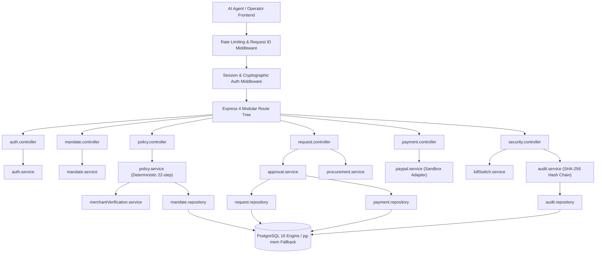

# Mandate Gateway — Backend Architecture Specification

## 1. System Overview

**STRAW HATS — MANDATE GATEWAY** is a sovereign, user-governed authorization, deterministic policy enforcement, and payment execution middleware situated between autonomous AI shopping agents and e-commerce merchants.

The backend is structured as a **modular monolith** in modern Node.js (ES modules), emphasizing high cohesion, loose coupling, deterministic financial safety, and zero external runtime dependencies for standard verification suites.



---

## 2. Layered Architecture & Directory Structure

```
server/
  index.js                    # Process lifecycle, graceful shutdown, listener
  app.js                      # Express application assembly, middleware pipeline, static SPA fallback

  config/
    env.js                    # Typed environment variables validation with fallbacks
    database.js               # Universal PostgreSQL pool & embedded pg-mem engine runner
    cors.js                   # Origin-restricted CORS with credential support

  routes/                     # Modular Express routers
    auth.routes.js            # /api/session, /api/login, /api/logout, /api/register
    dashboard.routes.js       # /api/dashboard
    mandates.routes.js        # /api/mandates (CRUD, revoke)
    agent.routes.js           # /api/agent (parse-brief, evaluate-candidates)
    policy.routes.js          # /api/policy/evaluate
    requests.routes.js        # /api/requests (7-stage lifecycle, approve, reject, dispute-pack)
    payments.routes.js        # /api/payments
    paymentMethods.routes.js  # /api/payment-methods (connect, toggle-freeze, limits)
    passports.routes.js       # /api/passports (mint, revoke, verify/:token)
    activity.routes.js        # /api/activity (ledger query, CSV/JSON export)
    security.routes.js        # /api/security (attacks, run-attacks, check-message, kill-switch)
    settings.routes.js        # /api/settings
    merchant.routes.js        # /api/merchants

  controllers/                # HTTP boundary: parameter parsing, validation, HTTP response formatting
    auth.controller.js
    dashboard.controller.js
    mandate.controller.js
    agent.controller.js
    request.controller.js
    payment.controller.js
    passport.controller.js
    security.controller.js
    activity.controller.js
    settings.controller.js

  services/                   # Pure business logic, deterministic policy rules, external rails
    auth.service.js           # Argon2/bcrypt credentials, session lifecycle
    mandate.service.js        # Budget reservations, ceiling validation
    policy.service.js         # Inviolable 22-step deterministic evaluation sequence
    procurement.service.js    # Spec extraction, catalog candidate scoring
    approval.service.js       # HITL / co-signer approvals, atomic budget utilization, dispute pack
    paypal.service.js         # PayPal REST v2 Orders adapter with deterministic sandbox fallback
    passport.service.js       # Cryptographic agent passport issuance & SHA-256 token verification
    audit.service.js          # Tamper-evident SHA-256 hash-chained event ledger
    killSwitch.service.js     # Global emergency stop governance
    merchantVerification.service.js # Domain canonicalization, homoglyphs, typosquatting defense

  repositories/               # Data Access Object (DAO) pattern executing parameterized SQL
    user.repository.js
    mandate.repository.js
    request.repository.js
    payment.repository.js
    passport.repository.js
    audit.repository.js
    merchant.repository.js
    settings.repository.js

  middleware/                 # Cross-cutting HTTP concerns
    auth.middleware.js        # Cookie, Bearer header, and session token verification
    validation.middleware.js  # Request body validation & CSV formula injection sanitization
    rateLimit.middleware.js   # IP-based sliding window rate limiters (standard, auth, AI)
    error.middleware.js       # Global RFC-7807 compliant error formatter
    requestId.middleware.js   # Distributed tracing correlation ID (X-Request-Id)

  validators/                 # Request schemas and parameter constraints
    auth.validator.js
    mandate.validator.js
    purchase.validator.js
    payment.validator.js

  database/
    migrations/               # Forward-only SQL migrations (001_initial_schema.sql)
    seeds/                    # Deterministic sample dataset (001_seed_demo_data.sql)

  utils/                      # Shared algorithmic utilities
    crypto.js                 # bcrypt, SHA-256, canonical JSON serializer
    money.js                  # Integer minor unit math (cents/paise), zero floating point
    errors.js                 # Standard HTTP error hierarchy (BadRequest, Unauthorized, etc.)
    logger.js                 # Structured logging with sanitization
```

---

## 3. Core Architectural Principles

### 3.1 Deterministic Invariance (Zero AI Hallucination Risk)
- AI shopping models are treated as **untrusted suggestion engines**.
- AI models may generate search queries and locate candidate items, but **NEVER make final clearance decisions**.
- Authorization decisions are computed strictly by `server/services/policy.service.js` using deterministic mathematical code.
- If any check fails, the policy verdict evaluates to `BLOCKED` or `FLAGGED_FOR_HUMAN` (fail-closed default).

### 3.2 Integer Minor Currency Units
- Floating-point representations (`0.1 + 0.2 === 0.30000000000000004`) are prohibited for financial calculations.
- All monetary attributes are persisted and calculated as integer minor units (`amount_minor`):
  - USD $10.50 -> `1050` minor units.
  - INR ₹8,495.00 -> `849500` minor units.
- Conversion functions in `server/utils/money.js` enforce round-half-up math and integer type validation.

### 3.3 Atomic Transactions & Concurrency Governance
- Budget reservations and order clearances occur within PostgreSQL database transactions (`BEGIN` ... `COMMIT`).
- Row-level locking (`SELECT ... FOR UPDATE`) prevents race conditions when concurrent autonomous agents request authorizations simultaneously against the same mandate.
- Available budget is checked in real-time: `(budget_ceiling - utilized_amount - reserved_amount) >= requested_amount`.
- Upon approval, `reserved_amount` is decremented and `utilized_amount` is atomically incremented.

### 3.4 Tamper-Evident SHA-256 Audit Ledger
- Every state mutation, policy evaluation, login, and kill-switch event is immutably appended to `audit_logs`.
- Each record computes:
  $$\text{event\_hash} = \text{SHA-256}(\text{previous\_hash} \,\|\, \text{actor\_id} \,\|\, \text{action} \,\|\, \text{entity\_id} \,\|\, \text{canonicalJSON}(\text{metadata}))$$
- An unbroken cryptographic chain prevents unauthorized ledger tampering.
- The `/api/security/verify-ledger` endpoint dynamically traverses and verifies the entire cryptographic chain.

### 3.5 Universal Database Engine Portability
- When `DATABASE_URL` is configured, `server/config/database.js` provisions a high-performance `pg.Pool` connection pool with SSL support.
- When `DATABASE_URL` is omitted (local developer workstations or CI runners without running PostgreSQL daemons), the system boots an embedded in-memory PostgreSQL engine (`pg-mem`).
- Identical SQL migrations (`001_initial_schema.sql`) and seed files (`001_seed_demo_data.sql`) execute on both drivers, guaranteeing zero environment drift.

