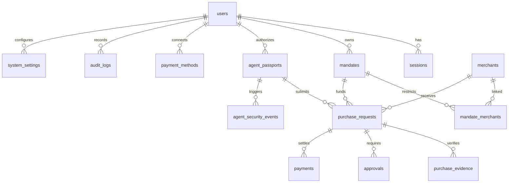

# Mandate Gateway — Database Schema & Data Dictionary

## 1. Schema Overview

The Mandate Gateway persistence layer is implemented in relational PostgreSQL 16 (executed via `pg` or the embedded `pg-mem` engine). All primary identifiers are UUIDv4 strings. All monetary amounts are stored as integer minor units (`BIGINT` / `INTEGER`) to prevent floating-point rounding inaccuracies.



---

## 2. Entity Definitions & DDL Specifications

### 2.1 `users`
Stores system operators and account holders.
```sql
CREATE TABLE users (
  id UUID PRIMARY KEY DEFAULT gen_random_uuid(),
  name VARCHAR(255) NOT NULL,
  email VARCHAR(255) UNIQUE NOT NULL,
  password_hash VARCHAR(255) NOT NULL,
  role VARCHAR(50) DEFAULT 'operator' CHECK (role IN ('operator', 'admin', 'auditor')),
  created_at TIMESTAMP WITH TIME ZONE DEFAULT CURRENT_TIMESTAMP,
  updated_at TIMESTAMP WITH TIME ZONE DEFAULT CURRENT_TIMESTAMP
);
```

### 2.2 `sessions`
Cryptographically hashes active operator authentication tokens.
```sql
CREATE TABLE sessions (
  id UUID PRIMARY KEY DEFAULT gen_random_uuid(),
  user_id UUID NOT NULL REFERENCES users(id) ON DELETE CASCADE,
  session_token_hash VARCHAR(64) UNIQUE NOT NULL,
  expires_at TIMESTAMP WITH TIME ZONE NOT NULL,
  revoked_at TIMESTAMP WITH TIME ZONE,
  created_at TIMESTAMP WITH TIME ZONE DEFAULT CURRENT_TIMESTAMP
);
```

### 2.3 `merchants`
Canonical registry of e-commerce merchants with homoglyph/typosquatting verification status.
```sql
CREATE TABLE merchants (
  id UUID PRIMARY KEY DEFAULT gen_random_uuid(),
  name VARCHAR(255) NOT NULL,
  canonical_domain VARCHAR(255) UNIQUE NOT NULL,
  verification_status VARCHAR(50) DEFAULT 'VERIFIED' CHECK (verification_status IN ('VERIFIED', 'UNVERIFIED', 'SUSPICIOUS', 'BLOCKED')),
  created_at TIMESTAMP WITH TIME ZONE DEFAULT CURRENT_TIMESTAMP
);
```

### 2.4 `mandates`
User-governed spending boundaries, categories, merchant rules, and budget limits.
```sql
CREATE TABLE mandates (
  id VARCHAR(64) PRIMARY KEY,
  user_id UUID NOT NULL REFERENCES users(id) ON DELETE CASCADE,
  name VARCHAR(255) NOT NULL,
  description TEXT,
  category VARCHAR(100) NOT NULL,
  currency VARCHAR(3) DEFAULT 'USD',
  budget_ceiling BIGINT NOT NULL CHECK (budget_ceiling >= 0),
  utilized_amount BIGINT DEFAULT 0 CHECK (utilized_amount >= 0),
  reserved_amount BIGINT DEFAULT 0 CHECK (reserved_amount >= 0),
  single_purchase_limit BIGINT NOT NULL CHECK (single_purchase_limit >= 0),
  human_approval_threshold BIGINT NOT NULL CHECK (human_approval_threshold >= 0),
  cosigner_threshold BIGINT NOT NULL CHECK (cosigner_threshold >= 0),
  status VARCHAR(50) DEFAULT 'active' CHECK (status IN ('active', 'paused', 'revoked', 'expired')),
  start_at TIMESTAMP WITH TIME ZONE DEFAULT CURRENT_TIMESTAMP,
  expires_at TIMESTAMP WITH TIME ZONE,
  created_at TIMESTAMP WITH TIME ZONE DEFAULT CURRENT_TIMESTAMP,
  updated_at TIMESTAMP WITH TIME ZONE DEFAULT CURRENT_TIMESTAMP
);
```

### 2.5 `mandate_merchants`
Relationship table linking mandates to approved or restricted merchants.
```sql
CREATE TABLE mandate_merchants (
  id UUID PRIMARY KEY DEFAULT gen_random_uuid(),
  mandate_id VARCHAR(64) NOT NULL REFERENCES mandates(id) ON DELETE CASCADE,
  merchant_id UUID NOT NULL REFERENCES merchants(id) ON DELETE CASCADE,
  created_at TIMESTAMP WITH TIME ZONE DEFAULT CURRENT_TIMESTAMP,
  UNIQUE(mandate_id, merchant_id)
);
```

### 2.6 `agent_passports`
Cryptographic credentials issued to autonomous shopping agents.
```sql
CREATE TABLE agent_passports (
  id VARCHAR(64) PRIMARY KEY,
  user_id UUID NOT NULL REFERENCES users(id) ON DELETE CASCADE,
  agent_name VARCHAR(255) NOT NULL,
  agent_identifier VARCHAR(100) UNIQUE NOT NULL,
  token_hash VARCHAR(64) NOT NULL,
  public_key TEXT,
  status VARCHAR(50) DEFAULT 'ACTIVE' CHECK (status IN ('ACTIVE', 'REVOKED', 'SUSPENDED', 'EXPIRED')),
  spending_limit BIGINT DEFAULT 0 CHECK (spending_limit >= 0),
  expires_at TIMESTAMP WITH TIME ZONE,
  created_at TIMESTAMP WITH TIME ZONE DEFAULT CURRENT_TIMESTAMP,
  revoked_at TIMESTAMP WITH TIME ZONE
);
```

### 2.7 `purchase_requests`
Orders passing through the 7-stage clearance lifecycle (`SUBMITTED`, `POLICY_EVALUATION`, `EVIDENCE_LOCKED`, `HITL_PENDING`, `AUTHORIZED`, `SETTLED`, `REJECTED`).
```sql
CREATE TABLE purchase_requests (
  id VARCHAR(64) PRIMARY KEY,
  user_id UUID NOT NULL REFERENCES users(id) ON DELETE CASCADE,
  mandate_id VARCHAR(64) NOT NULL REFERENCES mandates(id) ON DELETE RESTRICT,
  agent_passport_id VARCHAR(64) REFERENCES agent_passports(id) ON DELETE SET NULL,
  product_title VARCHAR(500) NOT NULL,
  merchant_id UUID REFERENCES merchants(id) ON DELETE SET NULL,
  merchant_name VARCHAR(255) NOT NULL,
  product_url TEXT,
  amount_minor BIGINT NOT NULL CHECK (amount_minor > 0),
  currency VARCHAR(3) DEFAULT 'USD',
  category VARCHAR(100),
  policy_verdict VARCHAR(50) NOT NULL CHECK (policy_verdict IN ('AUTO_CLEARED', 'FLAGGED_FOR_HUMAN', 'BLOCKED', 'PENDING')),
  status VARCHAR(50) DEFAULT 'SUBMITTED' CHECK (status IN ('SUBMITTED', 'POLICY_EVALUATION', 'EVIDENCE_LOCKED', 'HITL_PENDING', 'AUTHORIZED', 'SETTLED', 'REJECTED')),
  decision_reason TEXT,
  idempotency_key VARCHAR(128) UNIQUE,
  created_at TIMESTAMP WITH TIME ZONE DEFAULT CURRENT_TIMESTAMP,
  updated_at TIMESTAMP WITH TIME ZONE DEFAULT CURRENT_TIMESTAMP
);
```

### 2.8 `purchase_evidence`
Immutable snapshot of quote attributes, shipping fees, specifications, and evidence sources.
```sql
CREATE TABLE purchase_evidence (
  id UUID PRIMARY KEY DEFAULT gen_random_uuid(),
  purchase_request_id VARCHAR(64) NOT NULL REFERENCES purchase_requests(id) ON DELETE CASCADE,
  field_name VARCHAR(100) NOT NULL,
  expected_value TEXT,
  observed_value TEXT,
  evidence_source VARCHAR(255),
  verified BOOLEAN DEFAULT false,
  created_at TIMESTAMP WITH TIME ZONE DEFAULT CURRENT_TIMESTAMP
);
```

### 2.9 `approvals`
Audit of operator sign-off decisions for flagged orders or co-signer requirements.
```sql
CREATE TABLE approvals (
  id UUID PRIMARY KEY DEFAULT gen_random_uuid(),
  purchase_request_id VARCHAR(64) NOT NULL REFERENCES purchase_requests(id) ON DELETE CASCADE,
  approver_user_id UUID NOT NULL REFERENCES users(id) ON DELETE RESTRICT,
  approval_type VARCHAR(50) DEFAULT 'HITL' CHECK (approval_type IN ('HITL', 'COSIGNER')),
  status VARCHAR(50) DEFAULT 'PENDING' CHECK (status IN ('PENDING', 'APPROVED', 'REJECTED', 'EXPIRED')),
  token_hash VARCHAR(64),
  expires_at TIMESTAMP WITH TIME ZONE,
  consumed_at TIMESTAMP WITH TIME ZONE,
  created_at TIMESTAMP WITH TIME ZONE DEFAULT CURRENT_TIMESTAMP
);
```

### 2.10 `payment_methods`
Payment rails connected for simulated or live checkout (e.g., PayPal Sandbox, Virtual Cards).
```sql
CREATE TABLE payment_methods (
  id VARCHAR(64) PRIMARY KEY,
  user_id UUID NOT NULL REFERENCES users(id) ON DELETE CASCADE,
  provider VARCHAR(50) NOT NULL,
  provider_reference VARCHAR(255) NOT NULL,
  status VARCHAR(50) DEFAULT 'ACTIVE' CHECK (status IN ('ACTIVE', 'INACTIVE', 'REVOKED')),
  frozen BOOLEAN DEFAULT false,
  sandbox_mode BOOLEAN DEFAULT true,
  auto_approve_cap BIGINT DEFAULT 10000 CHECK (auto_approve_cap >= 0),
  spending_limit BIGINT DEFAULT 100000 CHECK (spending_limit >= 0),
  created_at TIMESTAMP WITH TIME ZONE DEFAULT CURRENT_TIMESTAMP
);
```

### 2.11 `payments`
Settled payment transactions recorded through payment providers.
```sql
CREATE TABLE payments (
  id VARCHAR(64) PRIMARY KEY,
  purchase_request_id VARCHAR(64) NOT NULL REFERENCES purchase_requests(id) ON DELETE RESTRICT,
  provider VARCHAR(50) NOT NULL,
  provider_order_id VARCHAR(255),
  provider_capture_id VARCHAR(255),
  amount_minor BIGINT NOT NULL CHECK (amount_minor > 0),
  currency VARCHAR(3) DEFAULT 'USD',
  status VARCHAR(50) DEFAULT 'PENDING' CHECK (status IN ('PENDING', 'COMPLETED', 'FAILED', 'REFUNDED')),
  idempotency_key VARCHAR(128) UNIQUE,
  created_at TIMESTAMP WITH TIME ZONE DEFAULT CURRENT_TIMESTAMP,
  updated_at TIMESTAMP WITH TIME ZONE DEFAULT CURRENT_TIMESTAMP
);
```

### 2.12 `audit_logs`
Tamper-evident, hash-linked cryptographic ledger records.
```sql
CREATE TABLE audit_logs (
  id VARCHAR(64) PRIMARY KEY,
  user_id UUID REFERENCES users(id) ON DELETE SET NULL,
  actor_type VARCHAR(50) NOT NULL,
  actor_id VARCHAR(255) NOT NULL,
  event_type VARCHAR(100) NOT NULL,
  entity_type VARCHAR(100) NOT NULL,
  entity_id VARCHAR(255) NOT NULL,
  action VARCHAR(100) NOT NULL,
  outcome VARCHAR(50) NOT NULL CHECK (outcome IN ('SUCCESS', 'DENIED', 'FAILURE', 'INFO')),
  metadata_json JSONB DEFAULT '{}',
  previous_hash VARCHAR(64) NOT NULL,
  event_hash VARCHAR(64) NOT NULL,
  created_at TIMESTAMP WITH TIME ZONE DEFAULT CURRENT_TIMESTAMP
);
```

### 2.13 `agent_security_events`
Security alerts generated by adversarial attacks, prompt injections, or scam messages.
```sql
CREATE TABLE agent_security_events (
  id UUID PRIMARY KEY DEFAULT gen_random_uuid(),
  agent_passport_id VARCHAR(64) REFERENCES agent_passports(id) ON DELETE SET NULL,
  attack_type VARCHAR(100) NOT NULL,
  severity VARCHAR(50) DEFAULT 'HIGH' CHECK (severity IN ('LOW', 'MEDIUM', 'HIGH', 'CRITICAL')),
  description TEXT NOT NULL,
  blocked BOOLEAN DEFAULT true,
  created_at TIMESTAMP WITH TIME ZONE DEFAULT CURRENT_TIMESTAMP
);
```

### 2.14 `system_settings`
Key-value configuration store for operator preferences, webhook relays, and default thresholds.
```sql
CREATE TABLE system_settings (
  id UUID PRIMARY KEY DEFAULT gen_random_uuid(),
  user_id UUID NOT NULL REFERENCES users(id) ON DELETE CASCADE,
  setting_key VARCHAR(100) NOT NULL,
  setting_value TEXT NOT NULL,
  updated_at TIMESTAMP WITH TIME ZONE DEFAULT CURRENT_TIMESTAMP,
  UNIQUE(user_id, setting_key)
);
```

---

## 3. Database Indexes

To maintain sub-millisecond lookups under high query volumes, the following performance indexes are enforced:
- `idx_sessions_token_hash`: `sessions(session_token_hash)`
- `idx_mandates_user`: `mandates(user_id)`
- `idx_passports_user`: `agent_passports(user_id)`
- `idx_requests_user`: `purchase_requests(user_id)`
- `idx_requests_mandate`: `purchase_requests(mandate_id)`
- `idx_requests_status`: `purchase_requests(status)`
- `idx_audit_created`: `audit_logs(created_at)`
- `idx_audit_entity`: `audit_logs(entity_type, entity_id)`
- `idx_audit_event_hash`: `audit_logs(event_hash)`
