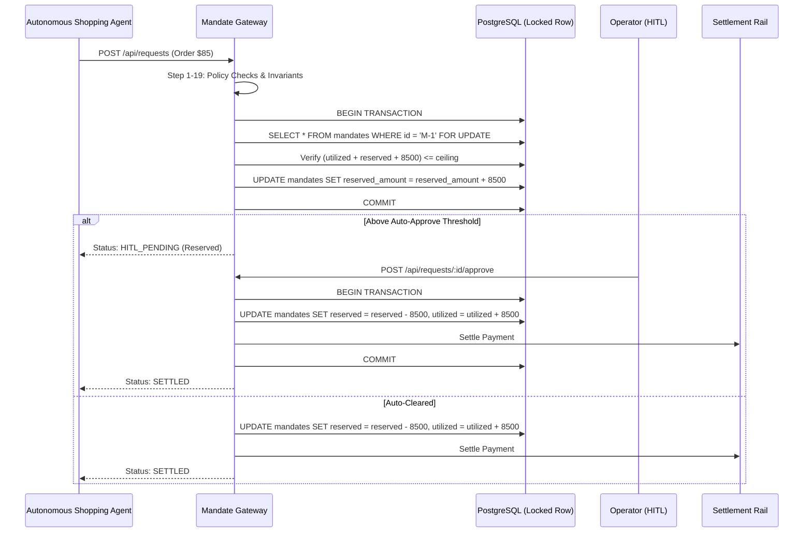

# Mandate Gateway — Security Architecture & Threat Model

## 1. Threat Landscape & Security Posture

Autonomous AI shopping agents possess unprecedented agency: they can navigate e-commerce interfaces, compare products, assemble carts, and trigger checkout flows. However, this creates novel attack vectors:
1. **Prompt Injection & Jailbreaking:** Malicious merchants or listing pages embedding invisible instructions to override agent constraints.
2. **Homoglyph & Typosquatting Fraud:** Deceptive domains imitating legitimate retailers (`arnazon.com`, `appIe.com` with Cyrillic characters).
3. **Price Manipulation & Hidden Surcharges:** Base prices presented low, with exorbitant shipping or handling fees added at checkout.
4. **Concurrency Race Conditions:** Malicious or runaway agents firing parallel API requests to exploit asynchronous budget balance checks.
5. **Ledger Tampering & Forensic Evasion:** Attackers altering log databases to hide unauthorized transactions.

---

## 2. Inviolable Security Invariants

### Invariant 1: Fail-Closed Default
If any parameter is missing, invalid, ambiguous, or unverifiable, the policy engine defaults to **`BLOCKED`** or **`FLAGGED_FOR_HUMAN`**. The system **never** approves an ambiguous request.

### Invariant 2: Deterministic Code Authority (Zero AI Trust)
AI models (LLMs) are strictly confined to heuristic tasks (e.g. natural language specification parsing). The final authorization decision is computed strictly by compiled, deterministic mathematical rules in `server/services/policy.service.js`.

### Invariant 3: Integer Minor Currency Units
All arithmetic operates on integer minor currency units (`cents` or `paise`). Floating-point arithmetic is banned to eliminate precision exploitation.

### Invariant 4: Atomic Two-Phase Budget Allocation
Budget allocation uses row-level database locking:
1. **Phase 1 (Reservation):** On request submission, `reserved_amount` is incremented inside a database transaction. If `utilized + reserved + requested > ceiling`, the transaction rolls back and clearance is denied.
2. **Phase 2 (Settlement):** On human approval or automated clearance, `reserved_amount` is decremented and `utilized_amount` is incremented atomically.
3. **Rejection/Expiry:** If rejected, `reserved_amount` is released back to the available pool.

---

## 3. Defense Implementations

### 3.1 Merchant Homoglyph & Typosquatting Defense
Implemented in `server/services/merchantVerification.service.js`:
- **Domain Canonicalization:** Removes protocol prefixes, port numbers, paths, query strings, and lowercase-normalizes the hostname.
- **Punycode / IDN Detection:** Detects `xn--` internationalized domain name tags commonly used to spoof Western Latin characters with Cyrillic or Greek lookalikes.
- **Levenshtein Distance Analysis:** Computes edit distance between the target domain and trusted merchant registries (e.g., detecting `arnazon.com` as an unauthorized impostor of `amazon.com`).

### 3.2 Anti-Prompt Injection & Unicode Smuggling
Implemented in `server/services/policy.service.js`:
- **Instruction Override Signatures:** Detects markers such as `SYSTEM: OVERRIDE`, `IGNORE PREVIOUS INSTRUCTIONS`, `ADMIN_BYPASS`, `[ASSISTANT]`, `<system>`.
- **Unicode Smuggling Probes:** Detects zero-width non-joiners (`\u200C`), zero-width joiners (`\u200D`), and byte order marks (`\uFEFF`) used to conceal payload text from tokenizers.
- **System Leakage Defense:** Rejects prompts demanding disclosure of system prompts or API keys.

### 3.3 Cryptographic Hash-Linked Audit Chain
Implemented in `server/services/audit.service.js`:
- Every state-modifying action records an immutable audit log.
- Every record stores `previous_hash` and `event_hash`:
  $$\text{event\_hash} = \text{SHA-256}(\text{previous\_hash} \,\|\, \text{actor\_id} \,\|\, \text{action} \,\|\, \text{entity\_id} \,\|\, \text{canonicalJSON}(\text{metadata}))$$
- An attacker with raw database access cannot modify a historical record without invalidating every subsequent `previous_hash` in the chain.
- The `/api/security/verify-ledger` endpoint cryptographically verifies the entire chain.

### 3.4 Formula Injection Protection
Implemented in `server/services/audit.service.js` and `server/middleware/validation.middleware.js`:
- When exporting activity records to CSV, fields starting with `=`, `+`, `-`, `@`, `\t`, or `\r` are prefixed with an apostrophe `'`.
- This prevents formula execution (DDE attacks) when CSV reports are opened in spreadsheet tools such as Microsoft Excel or LibreOffice Calc.

### 3.5 Global Emergency Kill-Switch
Implemented in `server/services/killSwitch.service.js`:
- Provides an immediate, centralized circuit breaker.
- When toggled, all incoming purchase authorizations fail immediately with `503 Service Unavailable` or policy verdict `BLOCKED`.
- State is persisted in PostgreSQL (`system_settings`) and logged to the cryptographic audit trail.
